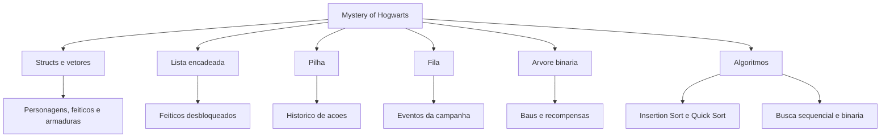

# Mystery of Hogwarts

## Projeto Final - Programação II

**Curso:** Engenharia de Software  
**Instituição:** Centro Universitário Campo Real  
**Professor:** Giovane Galvão  

### Integrantes

- Alexsandro
- Fabricio
- Lucas Borille
- Valentin

---

## 1. Sobre o projeto

Mystery of Hogwarts é um jogo de RPG desenvolvido em C++, inspirado no universo de Harry Potter.

O jogador poderá escolher um personagem, descobrir sua casa em Hogwarts, enfrentar inimigos em batalhas mágicas, ganhar experiência, desbloquear feitiços, equipar armaduras e avançar por uma campanha com diferentes desafios até a batalha final.

O projeto foi desenvolvido com o objetivo de aplicar os principais conceitos estudados durante o semestre de Programação II, como estruturas de dados, structs, vetores, ponteiros, recursividade e algoritmos de ordenação e busca.

## 2. História

O jogo se passa no universo de Hogwarts durante um período de conflito causado pelas forças das trevas.

O jogador assume o papel de um estudante que participa da resistência, enfrenta desafios, protege seus aliados e luta para salvar Hogwarts.

Cada personagem possui sua própria perspectiva dos acontecimentos, com diferentes narrativas e diálogos durante as missões.

### Histórias disponíveis

- Os Instrumentos Mortais
- Os Artifícios das Trevas

## 3. Funcionalidades implementadas

### Sistema de personagens

- Escolha entre quatro personagens.
- Atributos individuais para cada personagem.
- Sistema de vida (HP).
- Sistema de experiência (XP).
- Sistema de níveis (Level).
- Sistema de alimentação.

### Casas de Hogwarts

A escolha da casa é realizada através de um questionário com quatro perguntas. De acordo com as respostas, o jogador será direcionado para uma das seguintes casas:

- Grifinória.
- Corvinal.
- Sonserina.
- Lufa-Lufa.

### Sistema de feitiços

- Dez feitiços cadastrados.
- Dano individual para cada feitiço.
- Chance de acerto.
- Desbloqueio por experiência.

### Sistema de armaduras

O jogador poderá encontrar e equipar armaduras durante a campanha.

| Armadura | Alteração de vida |
|---|---:|
| Manto Inicial | +10 |
| Tênis Voador | +25 |
| Elmo Viking | +15 |
| Capa da Invisibilidade | +70 |
| Calcinha do Dumbledore | +70 ou -70 |

O inventário possui dois espaços destinados ao armazenamento de armaduras.

### Inventário

O inventário permite armazenar e utilizar recursos durante a campanha.

- Poções de cura.
- Poção Polissuco.
- Feijões mágicos.
- Sapos de chocolate.
- Armaduras.
- Espada da Grifinória.
- Chaves e fragmentos.

### Missões

- Quatro missões principais.
- Narrativas individuais para cada personagem.
- Sistema de combate em turnos.
- Recompensas em XP.
- Desafios necessários para o avanço da história.

### Minigames

Durante a campanha, o jogador poderá participar de cinco eventos:

- Bandido.
- Trasgo.
- Pedro Pettigrew.
- Dementador.
- Comensais da Morte.

### Mapa dos Marotos

O mapa permite acompanhar a localização do personagem durante a campanha, além de identificar os desafios encontrados e concluídos.

### Sistema de progressão

- Evolução até o nível 10.
- Desbloqueio automático de novos feitiços.
- Recompensas especiais.
- Gerenciamento de vida e alimentação.

### Batalha final

O jogo possui dois chefes finais:

- Voldemort.
- Ranrok.

O acesso à batalha final depende do progresso do jogador durante a campanha.

## 4. Personagens disponíveis

| Personagem | HP | HF | HM | HI |
|---|---:|---:|---:|---:|
| Luna Lovegood | 100 | 75 | 50 | 80 |
| Neville Longbottom | 100 | 80 | 50 | 60 |
| Simas Finnigan | 100 | 80 | 45 | 60 |
| Cedrico Diggory | 100 | 90 | 50 | 75 |

### Atributos

- HP: pontos de vida.
- HF: habilidade física.
- HM: habilidade mágica.
- HI: habilidade intelectual.
- XP: pontos de experiência.

## 5. Feitiços

| Feitiço | Dano | XP necessário | Chance base de acerto |
|---|---:|---:|---:|
| Reducto | 10 | 0 | 85% |
| Estupefaça | 20 | 0 | 85% |
| Incendio | 15 | 0 | 85% |
| Sectumsempra | 25 | 140 | 80% |
| Petrificus Totalus | 30 | 200 | 70% |
| Bombarda | 40 | 400 | 60% |
| Glacius | 65 | 700 | 50% |
| Crucius | 80 | 840 | 40% |
| Imperium | 80 | 950 | 40% |
| Avada Kedavra | 120 | 1200 | 30% |

Os feitiços são desbloqueados conforme o jogador ganha experiência e avança de nível.

## 6. Estruturas utilizadas

### Structs

As structs foram utilizadas para agrupar as informações relacionadas aos elementos do jogo.

- Jogadores.
- Feitiços.
- Armaduras.
- Inimigos.
- Estado da campanha.
- Nós das estruturas de dados.

### Vetores

Os vetores foram utilizados para armazenar os personagens, feitiços, armaduras, perguntas e diálogos disponíveis no jogo.

### R1 - Funções

O código foi dividido em funções responsáveis por diferentes partes do sistema, como cadastro de personagens, combate, inventário, missões e progressão.

A passagem por referência permite alterar diretamente os atributos do jogador durante a execução das funções.

### R2 - Ponteiros

Os ponteiros foram utilizados para armazenar os endereços de memória dos nós e realizar a ligação entre os elementos das estruturas de dados.

### R3 - Recursividade

A recursividade foi aplicada no algoritmo Quick Sort e nas funções de inserção, busca, travessia e liberação da árvore binária.

### R4 - Memória dinâmica

A alocação dinâmica foi utilizada na criação dos nós das estruturas de dados.

Os operadores `new` e `delete` são responsáveis pela alocação e liberação da memória utilizada.

### R5 - Lista encadeada

A lista encadeada foi utilizada para armazenar os feitiços desbloqueados pelo personagem.

Foram implementadas as operações de:

- Inserção.
- Remoção.
- Travessia.
- Liberação de memória.

### R6 - Pilha

A pilha foi utilizada para armazenar o histórico das ações realizadas pelo jogador.

Segue o princípio LIFO (Last In, First Out), em que o último elemento inserido é o primeiro a ser removido.

### R7 - Fila

A fila foi utilizada para organizar os eventos da campanha.

Segue o princípio FIFO (First In, First Out), em que o primeiro elemento inserido é o primeiro a ser removido.

### R8 - Árvore binária de busca

A árvore binária foi utilizada no sistema de baús misteriosos, permitindo localizar recompensas através de chaves numéricas.

Foram implementadas as operações de inserção, busca e travessia in-ordem.

### R9 - Algoritmos de ordenação

Foram implementados os algoritmos Insertion Sort e Quick Sort para ordenar os valores de dano dos feitiços.

| Algoritmo | Melhor caso | Caso médio | Pior caso |
|---|---|---|---|
| Insertion Sort | O(n) | O(n²) | O(n²) |
| Quick Sort | O(n log n) | O(n log n) | O(n²) |

A ordenação é realizada sobre uma cópia dos dados, preservando o inventário original.

### R10 - Algoritmos de busca

Foram implementadas a busca sequencial e a busca binária para localizar feitiços de acordo com seus valores de dano.

| Algoritmo | Complexidade média |
|---|---|
| Busca sequencial | O(n) |
| Busca binária | O(log n) |

O programa realiza a contagem de comparações para demonstrar a diferença entre os dois algoritmos.

A busca binária utiliza um vetor previamente ordenado.

## 7. Diagrama das estruturas de dados

## 10. Considerações finais

O desenvolvimento do Mystery of Hogwarts possibilitou a aplicação dos conteúdos estudados durante o semestre em um único projeto.

A proposta foi utilizar os conceitos de programação dentro das funcionalidades do jogo, relacionando as estruturas de dados e os algoritmos com as necessidades da campanha.

O projeto possui finalidade exclusivamente acadêmica, sem fins comerciais.

### Divisão de responsabilidades

O desenvolvimento do projeto foi dividido entre os quatro integrantes, de acordo com as funcionalidades propostas para o jogo.

#### Alexsandro

- Desenvolvimento do sistema de escolha das casas de Hogwarts.
- Elaboração do questionário de seleção das casas.
- Desenvolvimento das quatro missões principais.
- Definição das recompensas das missões.
- Desenvolvimento da estrutura e fluxo de código
- Relatório técnico
- Implementação de todas as structs de diálogos

#### Fabricio

- Desenvolvimento das condições de vitória.
- Verificação das missões concluídas.
- Verificação dos desafios necessários para a conclusão da campanha.
- Verificação da quantidade de feitiços desbloqueados.
- Validação das condições para a vitória final.

#### Lucas

- Desenvolvimento das batalhas finais.
- Implementação da batalha contra Voldemort.
- Implementação da batalha contra Ranrok.

#### Valentin

- Desenvolvimento dos cinco minigames.
- Definição dos atributos dos inimigos dos minigames.
- Implementação das recompensas dos desafios.
- Desenvolvimento do sistema de níveis e experiência.
- Implementação da progressão e do desbloqueio de feitiços.
